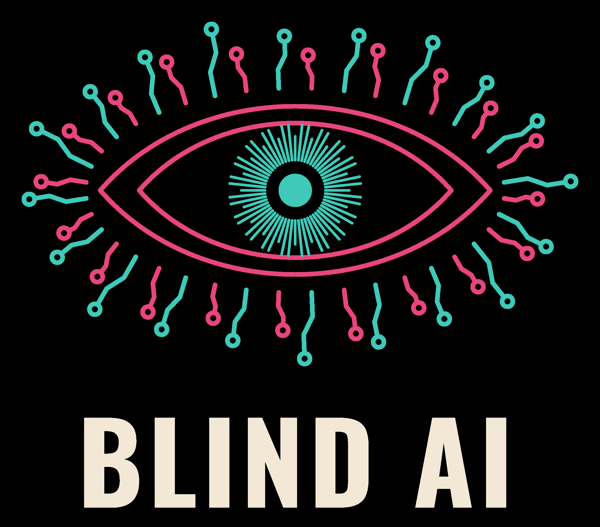

The Blind AI is Charli-Jo Tyrer's blog on AI and blindness: experiments tried that morning, first-hand dispatches, humour, longer accounts of the work, and the voices of its personas. It is also posted on Facebook.

## The desks

- [Charli-Jo Tyrer](https://charli.carrados.com/): first-hand dispatches.
- [dice](https://dice.carrados.com/): the unevenly distributed future.
- [Lucy Love-Child](https://lucy.carrados.com/): the Agent Wars.
- [Madison McDonnell](https://madison.carrados.com/): the Access Provocateur.
- [Down the Banksy](/desks/banksy/): public reprimands.

dice, Lucy, Madison and Down the Banksy are personas of Charli-Jo Tyrer. They're fictional. Their work isn't.

## Posts

<!-- list -->
