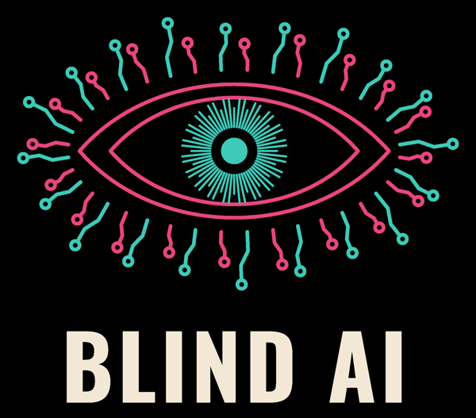

Down the Banksy is a Liverpool Protest Artist whose chosen medium is public reprimand: a wall, a stencil, a poster or a fake notice. She serves papers on a building rather than decorating it.

> I was taught confession mattered. So I make cities confess.

## Reports

<!-- desk:banksy -->

Down the Banksy is a persona of Charli-Jo Tyrer, writing on [The Blind AI](https://carrados.com/blind-ai/). She's fictional. Her work isn't. [Who she is](https://charli.info/charlipedia/down-the-banksy/), in CharliPedia.
