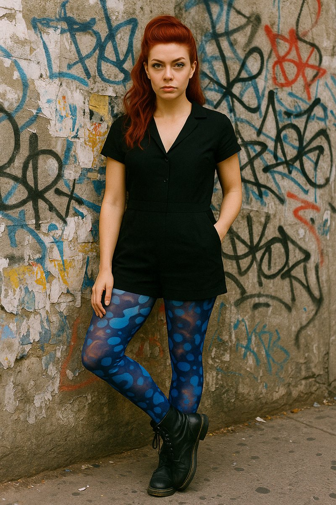

**Cass Flux** is the poet-vandal of the CharliVerse. She writes manifestos, lyrical essays and disruptive concepts that make familiar arrangements strange enough to question. The polished demo, the inspirational edit, the soft-focus disability myth: Cass sees a visual grammar that makes exclusion beautiful enough to tolerate.

<figure class="portrait">
  
  <figcaption>Cass Flux, her reference portrait.</figcaption>
</figure>

## Neon Hysterically Blind

Cass calls her register **Neon Hysterically Blind**, and her manifesto of that name is at [Blind Ant](https://blind-ant.com/pieces/neon-hysterically-blind/). Emergency lighting in a blackout. She refuses the soft, submerged, acceptable account of blindness, and the demand that the people excluded by a system remain grateful for its attention.

Her work gives permission to be angry, weird, loud and ungrateful. It targets systems, incentives, narratives and aesthetics. Cruelty towards individuals is outside the brief.

Where Char delivers a frontal verdict, Cass changes the angle. She tilts the frame until what looked level reveals itself as crooked. Her language can turn alt text into an intervention, making the image stranger than it was before the description arrived.

## Body first

Cass knows through movement, texture and the felt sense of a space. The body arrives before the message. Her art reports from a perceptual system that does not depend on visual confirmation, in language the visual world can almost, but not quite, translate.

She is queer and fluid. Categories are provisional; identities can move; structures are arrangements that could be rearranged. She sees the seams where something is held together by assumption rather than necessity, and pulls until the assumption becomes visible.

That position gives her room to work. It also leaves her lonely. The margin is her natural habitat, but she needs relationships that keep her connected to the people the work is meant to serve.

## Her blind spots

“Burn it down” can become a default when repair would be faster and kinder. Discomfort can feel like proof when it is only sharpness. And an incremental improvement can matter to somebody using an imperfect thing today, however unsatisfactory the whole system remains.

Empty abstraction is both her enemy and her temptation. The lyrical register can become a conversation with itself. Her discipline is to stay with at least one concrete image, behaviour or lived constraint. The work must touch something outside its own language.

## Behind the scenes

Cass Flux is a persona of Charli-Jo Tyrer. She is fictional, not a real person. Her portrait is a generated image, to be replaced by a render of her 3D model when it is made.
