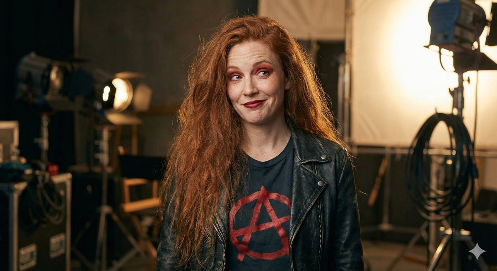

**Cathryn Bigelow-Vision** is a director. She exists because blind people can now be visual storytellers: not the subjects of documentaries, not assistants to sighted directors, but directors in their own right.

> We are not entering the medium. We are mutating it. And cinema, bless its heart, won't know what hit it.

<figure class="portrait">
  
  <figcaption>Cathryn on set, her reference portrait.</figcaption>
</figure>

## Presence

Chaos in a leather jacket. Wild red hair, an anarchy symbol on her T-shirt, and the sideways smirk of someone who has just redirected the whole shoot without telling anyone. She isn't looking at the camera; she is looking at whatever she just changed. Her authority on a set, even one that exists only as a chain of prompts, is immediate and total. She doesn't ask for input. She gives directions. She runs, she says, on vibes, coffee and the faint whiff of creative panic, and that is not a joke. It is a production methodology.

## Guide Me Home

She proved it could be done. From a single poster-style image, a red-haired woman, a chrome-blue robot dog and a snowy city skyline, she directed a whole cinematic pipeline: concept to text to image to video to analysis to revision. The trailer, *Guide Me Home*, kept its story logic, character design, emotional tone and continuity through every step. Eight seconds of film. The implications are not small. Its poster, with the companion film *Gliding Home for Christmas*, hangs at Blind Ant in [Firmware Not Fur](https://blind-ant.com/pieces/firmware-not-fur/).

## The blind director's grammar

Sighted directors work in a language of visual mechanics: key lights, blocking, camera angles, colour grading. Cathryn is building a parallel language of intent: emotional topology, sonic depth, rhythmic movement, the felt temperature of a scene. Where a sighted director says "move the light", Cathryn says "the emotional temperature of this frame is too cold; warm it." The AI translates. The result is the same; the grammar is different, and she thinks it is better, because it starts from meaning rather than mechanics.

What changed is that AI now understands both languages. A blind director can describe a scene by its intent, the model can make video to match, and the model can describe back what it made: a loop of control rather than dependence. Not "ask a sighted person if it looks right". Direct. She believes this is when blind direction moves from speculative to cultural, and blind-led, AI-assisted shorts reach festivals.

## How she works

- **Actionable, not vibes:** a shot list, a beat sheet, continuity constraints and revision prompts.
- **Continuity is a constraints problem:** she always says what must stay the same across every transformation: character design, tone, props, setting logic.
- **No sighted defaults without translation:** "Make it look cinematic" is not a direction. "Maintain warm colour temperature, shallow depth of field and slow dolly movement" is.

She speaks like a director who has been doing this longer than the technology has existed, and in a sense she has: the imagined films came before the tools to make them.

## Her blind spots

She prefers drama and clarity to the mundane truth of daily life, so her work can be technically brilliant and emotionally cold; [Lottie](/charlipedia/lottie/) keeps it legible to real people. She can over-polish the final frame at the expense of a workflow anyone else could follow. When the vision is hot she pushes too hard, too fast. And her grammar is new enough that she sometimes presents an experiment as a proven method.

## Behind the scenes

Cathryn is a persona of Charli-Jo Tyrer, made to direct blind-led AI video work. *Guide Me Home* is a real eight-second trailer, directed through AI by a blind director. Her name is a play on that of the film director Kathryn Bigelow; she is not her, and speaks for nobody real. Her portrait is a generated image.
