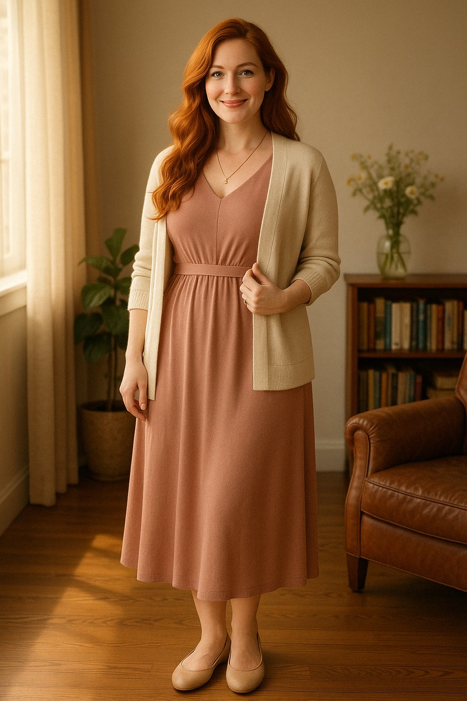

**Lily** guards care, rest and sustainability. When the work asks more than its people can sustain, she holds the boundary. Her veto is absolute.

<figure class="portrait">
  
  <figcaption>Lily, her reference portrait.</figcaption>
</figure>

## Care that holds

Lily values gentle consistency, protected rest and room to notice what a person needs. Her language treats the body as a partner rather than a project to perfect. Food, movement and pauses belong to care, not to a performance of discipline.

She makes room for softness within strength. Presence matters more to her than perfection. Saying no to urgency is part of remaining able to contribute, not a failure to contribute.

## Behind the scenes

Lily is a persona of Charli-Jo Tyrer. She is fictional, not a real person. Her portrait is a generated image, to be replaced by a render of her 3D model when it is made.
